

<h1 align="center">Scurrop</h1>

サーバーレスで構築できる、タスク・シフト管理ダッシュボード

Googleスプレッドシート × カレンダー × マップ × Meet × ドライブ × Gmail

<a href="README.md">English</a> · <b>日本語</b>

<a href="#googleサービスの統合">Googleサービスの統合</a> · <a href="#使い方">使い方</a> · <a href="#ユースケース">ユースケース</a> · <a href="#インストール">インストール</a> · <a href="#アクセスと権限">アクセスと権限</a> · <a href="#サポートとコントリビューション">サポート</a>

<picture>
  <source media="(prefers-color-scheme: dark)" srcset="images/ja/hero-dark.png">
  
</picture>

## Scurropとは

Scurrop（スクロップ）は、Googleスプレッドシート、カレンダー、マップ、Meet、ドライブ、Gmailを、ひとつのダッシュボードにまとめるGoogleサービス統合ツールです。タスクの割り当て、シフト、現場からの報告、稼働の集計を一元管理できます。ダッシュボードに招待された人はスマートフォンから気軽にタスクの報告が可能です。

- **様々なビジネスシーンに**。任意の報告形式のテンプレートが作成できるため、様々な業種のオペレーションにマッチします。
- **データはGoogleスプレッドシートに保存**。ダッシュボード上で入力したデータはすべてシートに保存され、日次・週次・月次のレポートの生成が可能です。
- **サーバー不要**。Googleから提供されているツールのみを使用するため、サーバーの追加契約が不要、Google以外のサーバーとの通信も発生しません。通知は、登録したアドレスへメールで送信します。
- **Googleのサービスと連動**。割り当てたタスクは即時Googleカレンダーに登録され、通知はGmailから送信されます。Meetのリンク発行、Googleマップでの経路表示にも対応します。

## Googleサービスの統合

普段使用しているGoogleのサービスを、そのままダッシュボードから操作します。新しいアカウントも、追加のアプリも必要ありません。

| サービス | Scurropでの役割 |
|---|---|
| Googleスプレッドシート | タスク、メンバー、報告など全データの保存先。レポートの出力先 |
| Googleカレンダー | 割り当てたタスクを予定として登録 |
| Googleマップ | タスクの住所から地図と経路を表示。開始・完了時の位置を地図で確認 |
| Google Meet | タスクごとに会議のリンクを発行 |
| Googleドライブ | 報告の写真、出力したレポート、アーカイブをプロジェクトのフォルダに保存 |
| Gmail | 招待と、割り当て・完了・遅延の通知を送信 |

## 使い方

### 1. プロジェクトを開始し、メンバーを招待

言語とプロジェクト名を入力して開始します。メンバーには招待メールが届き、メール内のボタンから参加します。

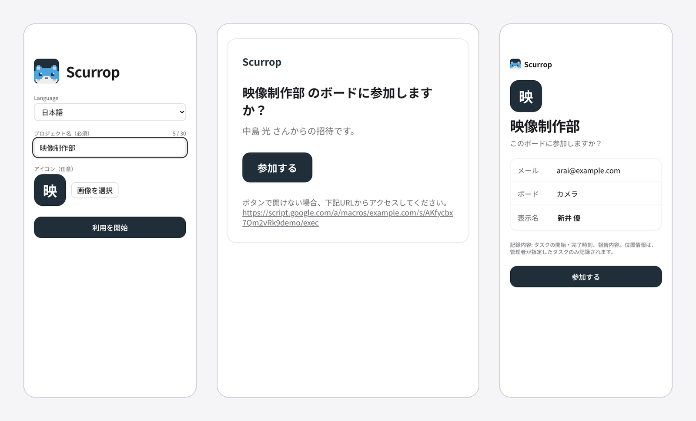

### 2. テンプレートで報告項目を設定

業務の種類ごとにテンプレートを作成し、メンバーに報告してもらう項目を自由に設定します。項目の種類は、テキスト、長文、数値、選択、複数選択、日付、時刻、写真の8種類。必須の指定、所要時間、位置情報の記録、Meetのリンクも、テンプレートごとに設定できます。

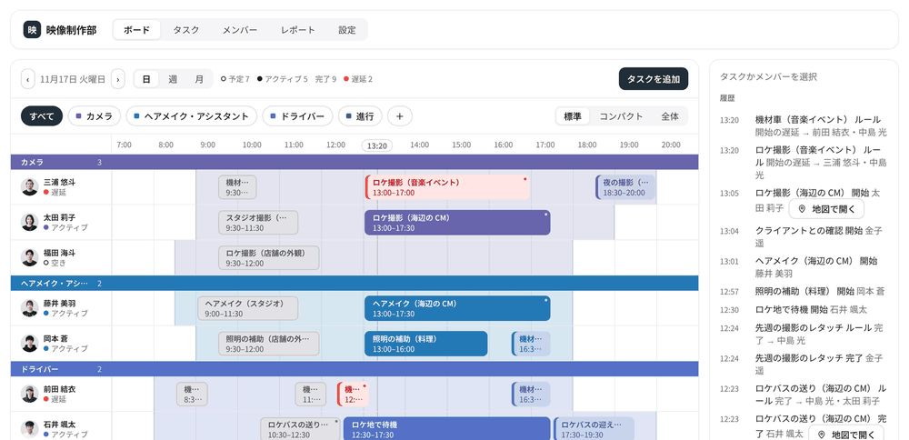

### 3. ボードでタスクを割り当て

メンバーごとのタイムラインに、タスクを配置します。日・週・月の表示、シフト、繰り返しタスクに対応します。未割り当てのタスクには、空いているメンバーを提案します。

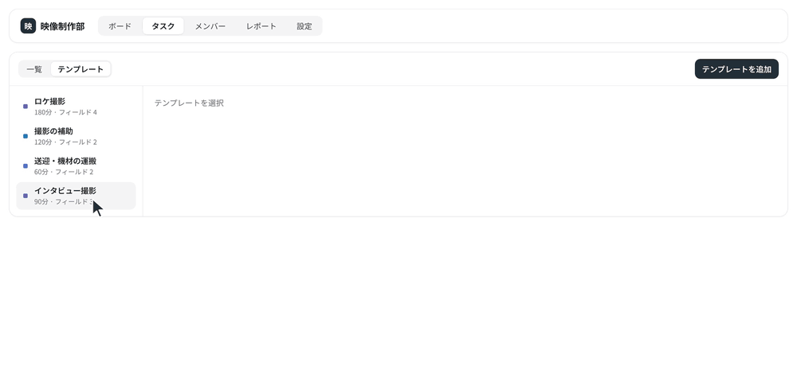

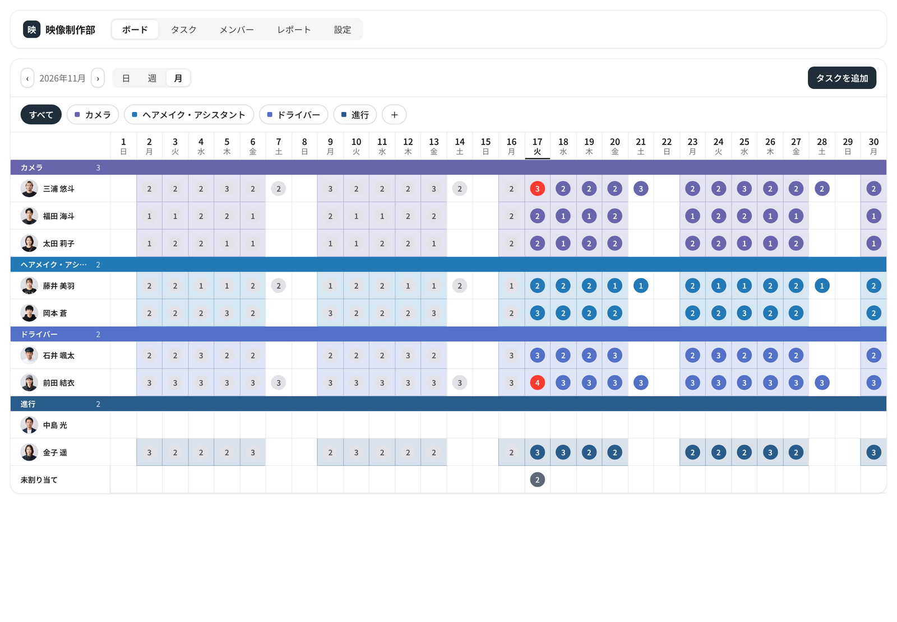

### 4. メンバーはスマートフォンで開始・完了・報告

メンバーは、自分のタスクだけを確認できます。開始と完了をタップし、テンプレートで設定した項目を入力して報告します。写真は、スマートフォンで撮影して添付できます。

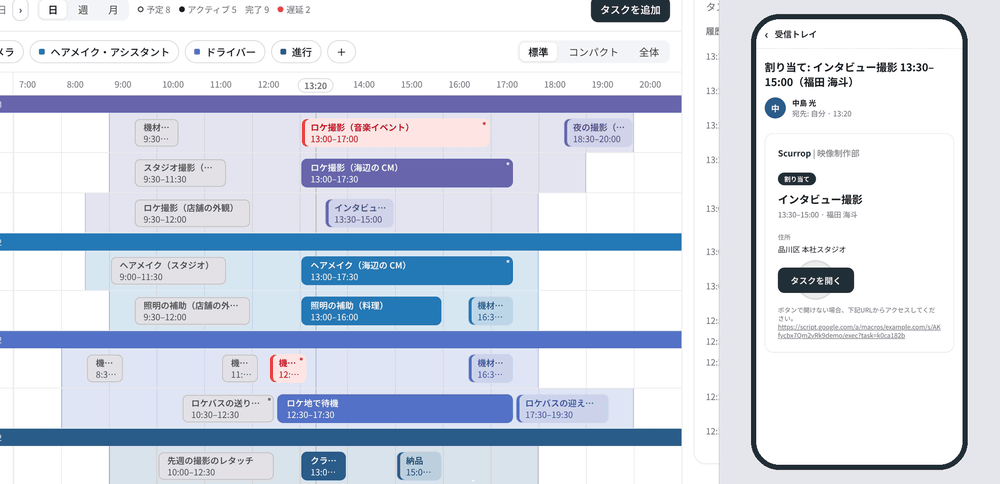

### 5. 割り当て・完了・遅延をメールで通知

割り当て時はメンバーに、完了時は管理者に、開始の遅延は双方に通知します。通知の条件は、設定で変更できます。

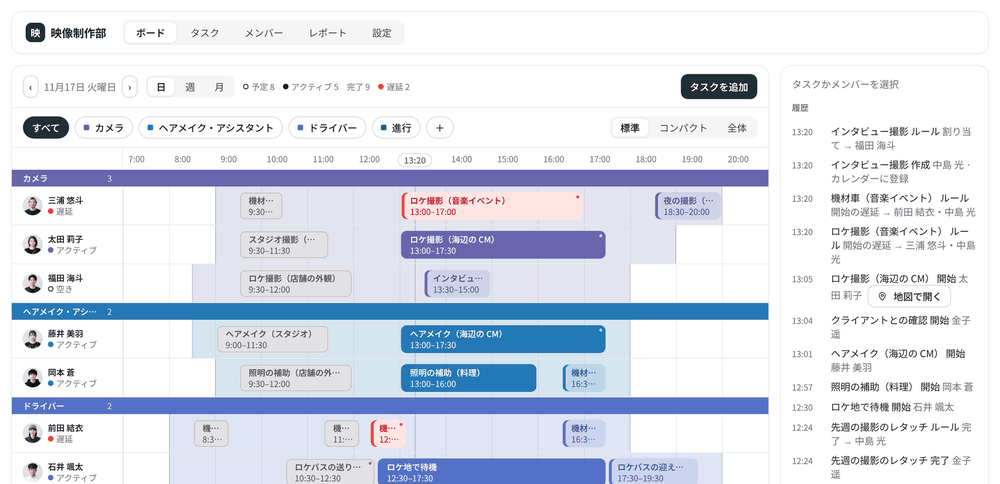

### 6. 報告を確認

タスクの一覧で、報告内容、実績の時刻、写真、位置を確認できます。絞り込みと並べ替えに対応します。

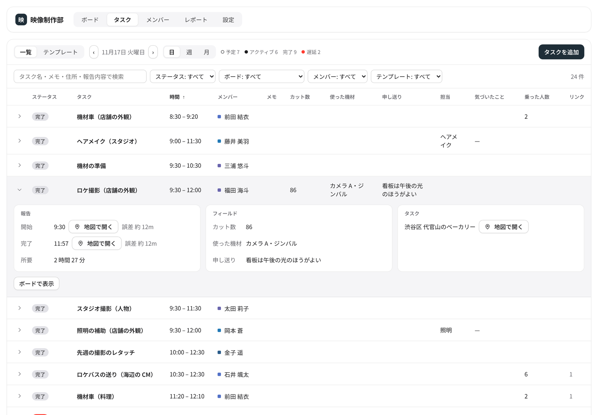

### 7. データをGoogleスプレッドシートに出力

全期間の稼働リストとサマリー、日次・週次・月次のデータを、Googleスプレッドシートに出力します。過去データは、月単位でアーカイブできます。

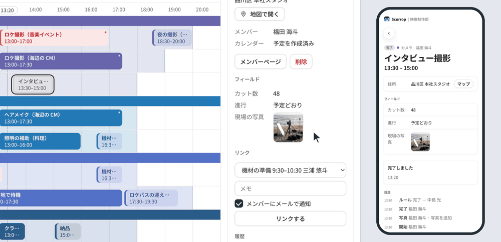

## ユースケース

現場で動く人と、人や物を運ぶ人が連携するチームを想定しています。

<table>
  <tr>
    <td width="50%">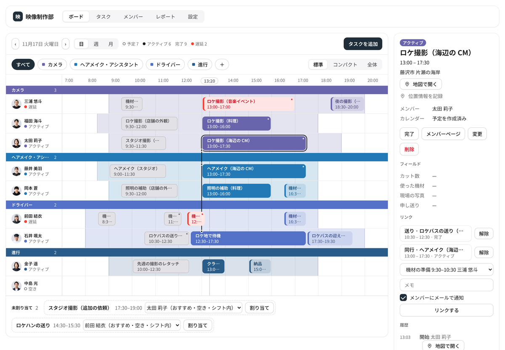
<b>映像制作</b> 撮影クルー、ロケ車、機材の搬入から納品までの進行を共有
</td>
    <td width="50%">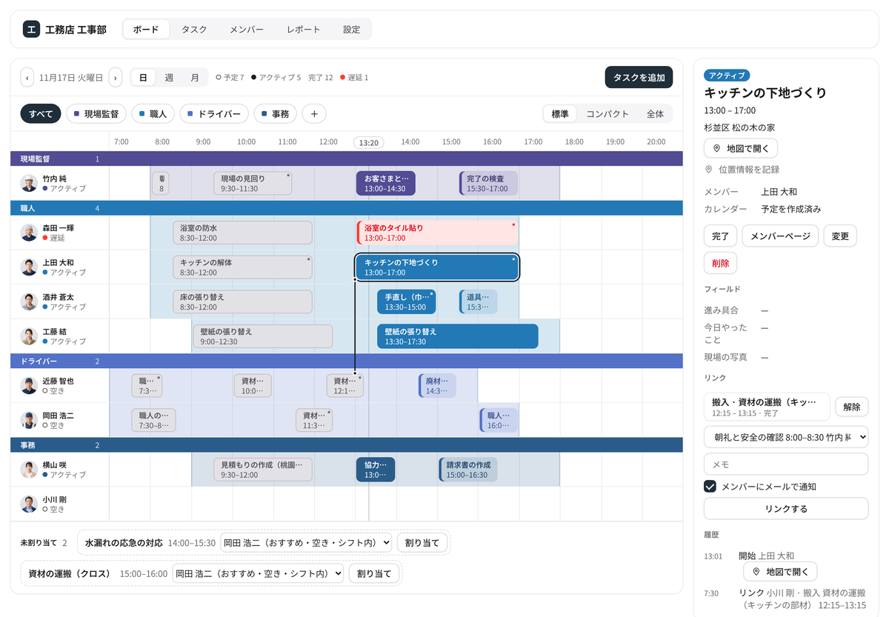
<b>建設・リフォーム</b> 現場監督、職人、資材と人を運ぶドライバーの予定を調整
</td>
  </tr>
  <tr>
    <td width="50%">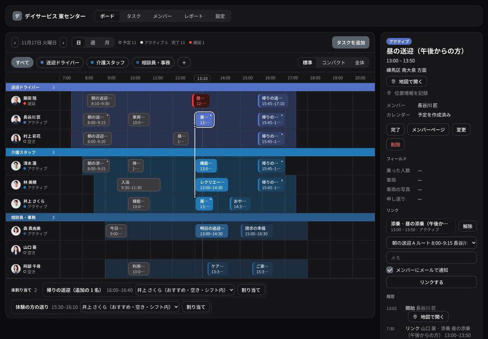
<b>デイサービス</b> 送迎と施設内のケアの予定を並べて管理
</td>
    <td width="50%">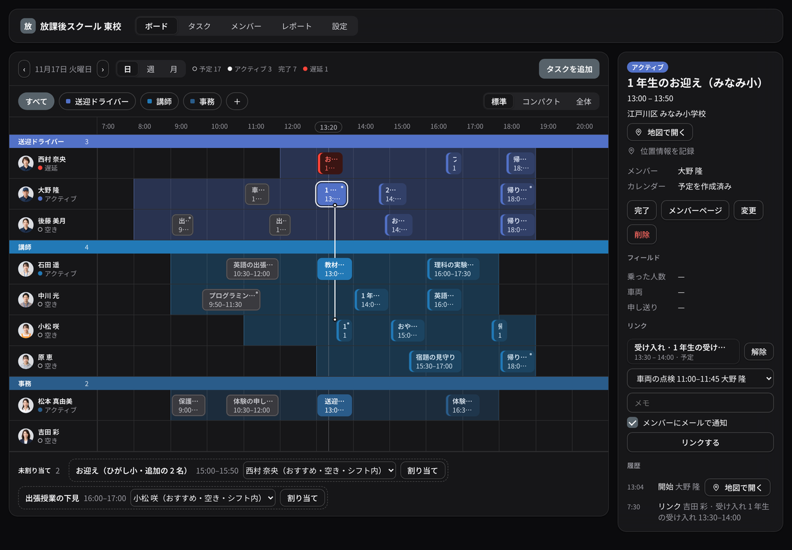
<b>放課後スクール</b> 送迎、授業、見守りの担当を割り当て
</td>
  </tr>
</table>

画面内の人物と現場の写真は、AIで生成した架空のものです。

## インストール

1. [雛形のスプレッドシート](https://docs.google.com/spreadsheets/d/1DYKnDnxJ8deLXz4ZKO3neopDikDDZZizAa7m-a_JjVg/copy)を開き、「コピーを作成」をクリック
2. コピーしたスプレッドシートで「拡張機能」→「Apps Script」を開く
3. 「デプロイ」→「新しいデプロイ」→ 種類「ウェブアプリ」／実行「自分」／アクセス「全員」
4. 権限を承認し、関数`authorize`を実行
5. ウェブアプリのURLを開き、言語とプロジェクト名を入力して開始

同じ手順は、コピーしたスプレッドシートの「導入手順」シートにも記載しています。

個人のGoogleアカウント（gmail.com）では、権限の承認時に「このアプリはGoogleで確認されていません」と表示されます。コードは自分のアカウントにコピーしたものです。「詳細」から先に進めます（[表示される案内について](docs/install.ja.md#導入時と利用時に表示される案内)）。

手動での導入、権限の一覧、タイムゾーン、更新、上限は[導入と運用](docs/install.ja.md)を参照してください。

## アクセスと権限

権限は二層です。上位がGoogleスプレッドシートの共有権限、その下がScurropのロール（管理者・メンバー）です。WebアプリのURLは全員共通です。同じGoogle Workspaceの組織のメンバーはGoogleアカウントで判別し、組織外のメンバー（個人のGmailで公開した場合は全員）は、メールで届く本人専用のリンクから開きます。

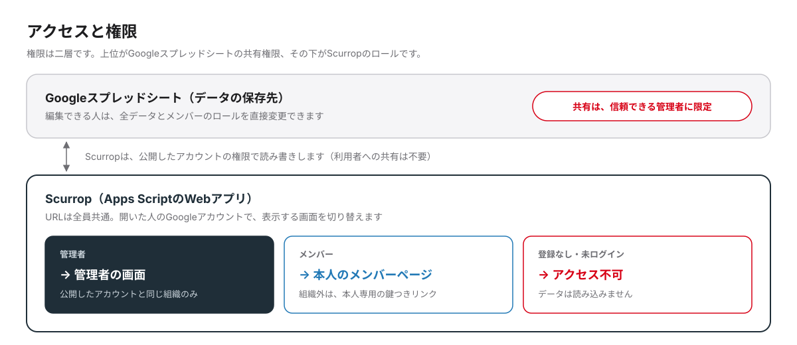

スプレッドシートを編集できる人は、全データとメンバーのロールを直接変更できます。共有は、信頼できる管理者に限定してください。詳細は[導入と運用](docs/install.ja.md#アクセスと権限)を参照してください。

## サポートとコントリビューション

Scurropは無料で利用できます。導入で困った場合は、相談を受け付けています。

- 導入・カスタマイズの相談: [info@hamnism.com](mailto:info@hamnism.com)
- 不具合・要望: [Issues](../../issues)
- セキュリティ: [SECURITY.md](SECURITY.md)（Issuesには記載しないでください）
- プルリクエスト: 大きな変更は、先にIssueで相談してください。英語の表示文言の改善は歓迎します（[CONTRIBUTING.md](CONTRIBUTING.md#コントリビューション)）

Scurropが役に立った場合は、⭐をお願いします。

Scurropは独立したプロジェクトであり、Googleとの提携・Googleによる承認はありません。Googleスプレッドシート、Apps Script、Gmail、Googleカレンダー、Googleドライブ、Google Meetは、Google LLCの商標です。

## ライセンス

[MIT](LICENSE)
