

<h1 align="center">Scurrop</h1>

A serverless dashboard for task and shift management

Google Sheets × Calendar × Maps × Meet × Drive × Gmail

<b>English</b> · <a href="README.ja.md">日本語</a>

<a href="#google-services-in-one-place">Google services</a> · <a href="#how-it-works">How it works</a> · <a href="#use-cases">Use cases</a> · <a href="#install">Install</a> · <a href="#access-and-permissions">Access and permissions</a> · <a href="#support-and-contributing">Support</a>

<picture>
  <source media="(prefers-color-scheme: dark)" srcset="images/en/hero-dark.png">
  
</picture>

## What is Scurrop

Scurrop brings Google Sheets, Calendar, Maps, Meet, Drive and Gmail together in one dashboard. Assign tasks, plan shifts, collect reports from the field and total up working time in one place. People invited to the dashboard can report on their tasks easily from a smartphone.

- **For many kinds of work.** You can build templates for any report format, so it fits operations in many industries.
- **Data is stored in Google Sheets.** Everything entered on the dashboard is saved to the sheet, and daily, weekly and monthly reports can be generated.
- **No server.** Scurrop uses only tools provided by Google, so there is no extra server to contract and no data goes to servers other than Google's. Notifications are sent by email to the addresses you register.
- **Works with Google services.** Assigned tasks are added to Google Calendar immediately, and notifications are sent from Gmail. Meet links and Google Maps directions are supported.

## Google services in one place

Scurrop works with the Google services you already use, straight from the dashboard. No new accounts and no extra apps.

| Service | What Scurrop does with it |
|---|---|
| Google Sheets | Stores all data: tasks, members and reports. Exports go here too |
| Google Calendar | Adds assigned tasks as events |
| Google Maps | Opens the map and directions from a task's address, and shows where a task was started and completed |
| Google Meet | Creates a meeting link per task |
| Google Drive | Keeps report photos, exported reports and archives in the project folder |
| Gmail | Sends invitations and the assignment, completion and delay notifications |

## How it works

### 1. Start a project and invite members

Choose a language, enter a project name and start. Members receive an invitation email and join from the button in it.

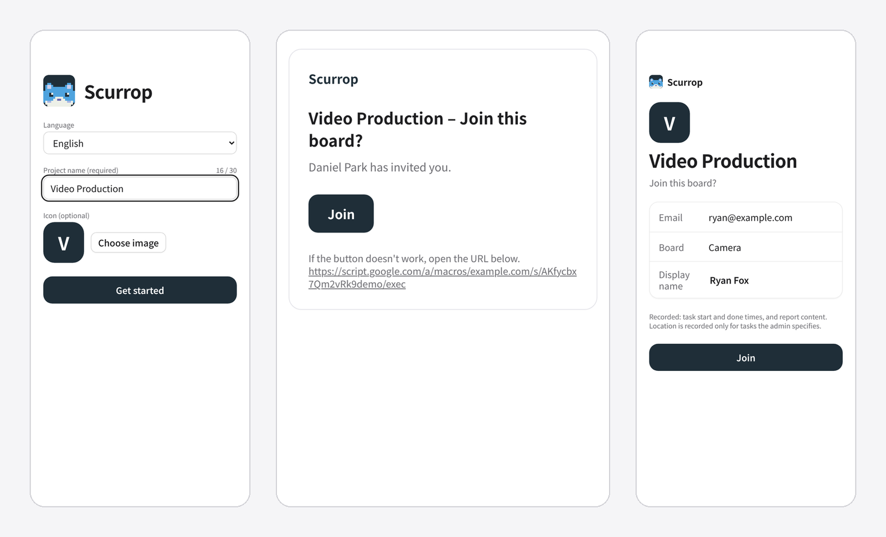

### 2. Set the report fields in a template

Create a template for each kind of work and choose the fields members report. There are eight field types: text, long text, number, select, multi-select, date, time and photo. Required fields, duration, location recording and a Meet link are also set per template.

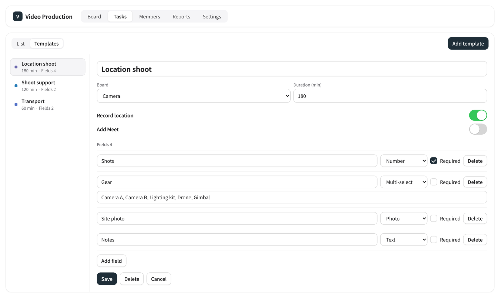

### 3. Assign tasks on the board

Place tasks on each member's timeline. Day, week and month views, shifts and repeating tasks are supported. For unassigned tasks, Scurrop suggests a member who is free.

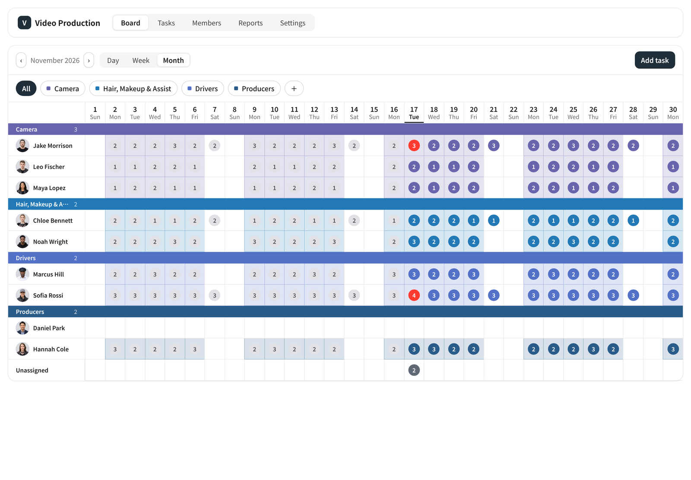

### 4. Members start, finish and report on their phones

Members see only their own tasks. They tap to start and finish, then fill in the fields set in the template. Photos can be taken on the phone and attached.

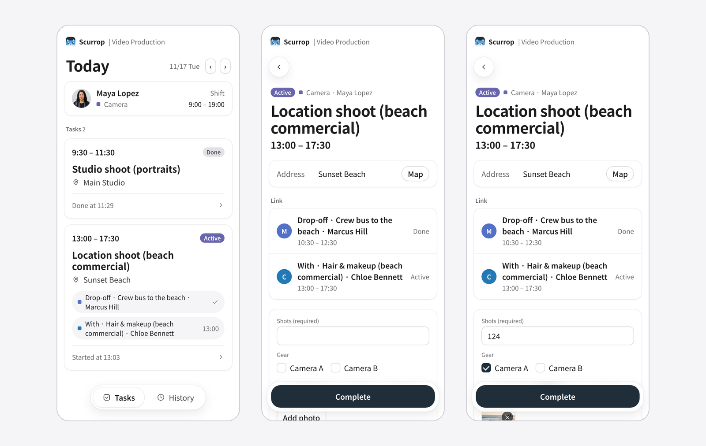

### 5. Assignment, completion and delays are sent by email

Members are notified when a task is assigned, admins when it is completed, and both when a start is late. You can change the notification rules in Settings.

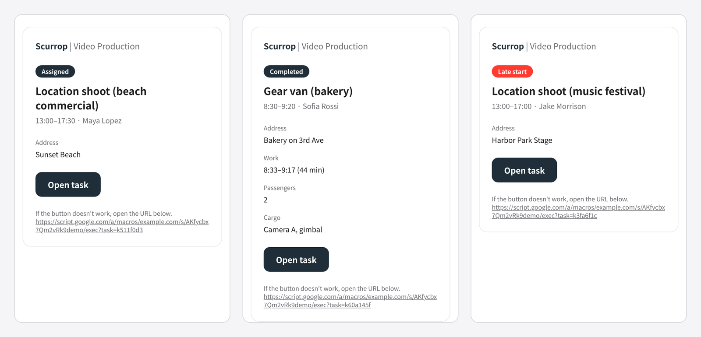

### 6. Review the reports

The task list shows report contents, actual times, photos and locations. You can filter and sort it.

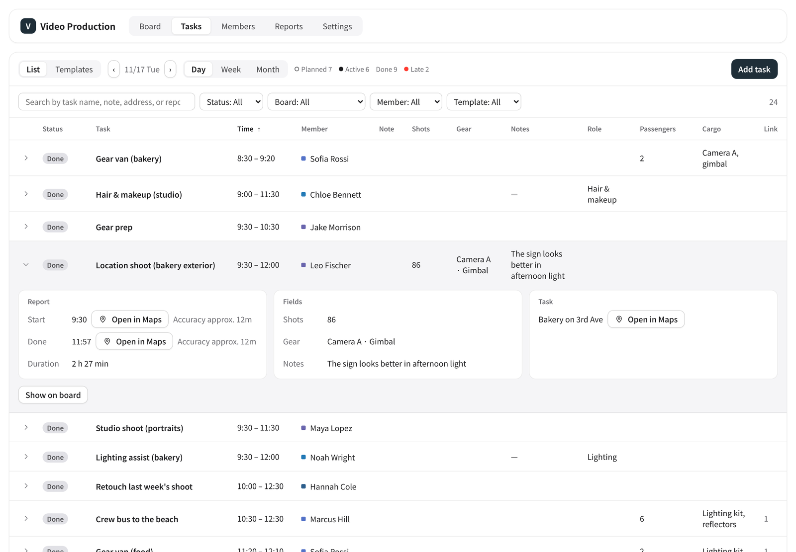

### 7. Export the data to Google Sheets

Export the full work log with a summary, and daily, weekly or monthly data, to Google Sheets. Past data can be archived by month.

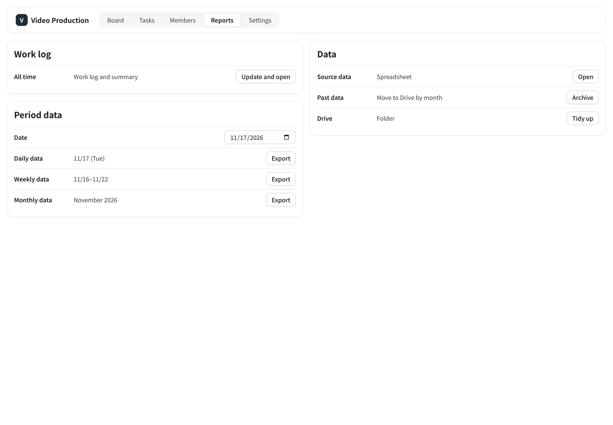

## Use cases

Scurrop is designed for teams where people on site work together with people who move staff and materials.

<table>
  <tr>
    <td width="50%">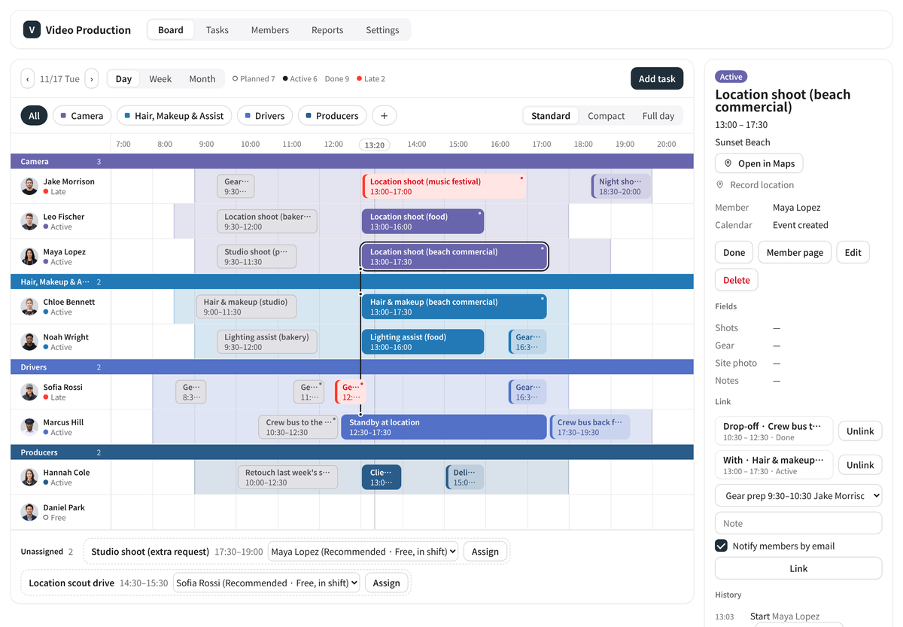
<b>Video production</b> Share progress from crew and vehicle booking through equipment load-in to delivery
</td>
    <td width="50%">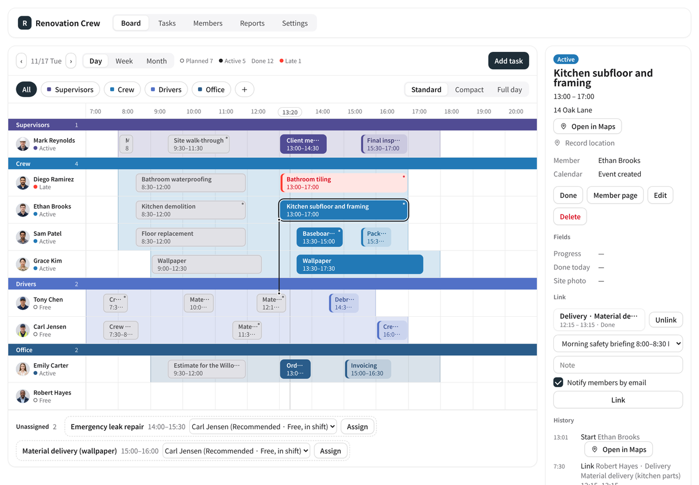
<b>Construction and renovation</b> Coordinate site managers, crews and the drivers who move people and materials
</td>
  </tr>
  <tr>
    <td width="50%">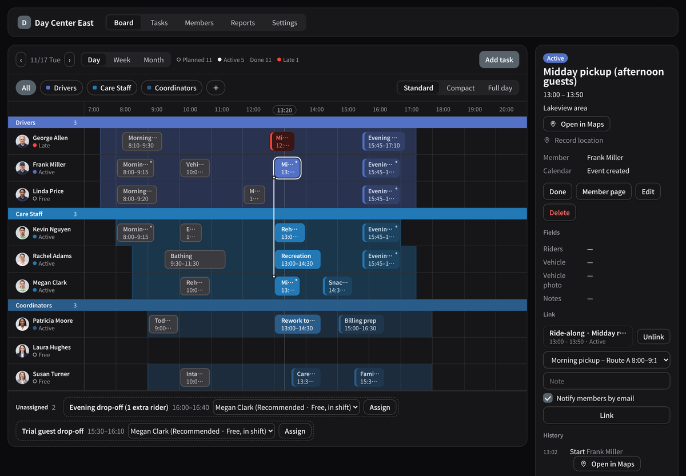
<b>Adult day care</b> Manage transport and on-site care side by side
</td>
    <td width="50%">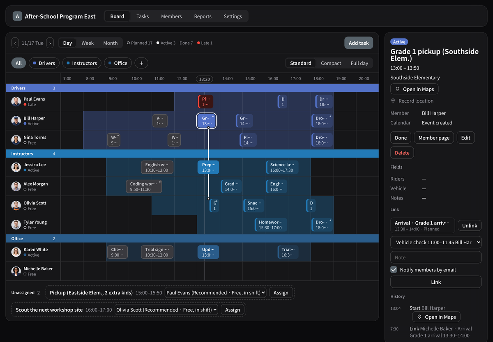
<b>After-school programs</b> Assign transport, classes and supervision
</td>
  </tr>
</table>

The people and site photos in the screenshots are fictional, AI-generated images.

## Install

1. Open [the template spreadsheet](https://docs.google.com/spreadsheets/d/1DYKnDnxJ8deLXz4ZKO3neopDikDDZZizAa7m-a_JjVg/copy) and click "Make a copy"
2. In the copied spreadsheet, open Extensions → Apps Script
3. Deploy → New deployment → type "Web app" / Execute as "Me" / Access "Anyone"
4. Authorize, then run the function `authorize`
5. Open the web app URL, choose a language, enter a project name and start

The same steps are in the "Install" sheet of the copied spreadsheet.

With a personal Google account (gmail.com), "Google hasn't verified this app" appears when you authorize. The code is the copy in your own account. Continue from "Advanced" ([about the notices](docs/install.md#notices-shown-during-install-and-use)).

For manual install, the list of permissions, time zone, updating and limits, see [Install and operate](docs/install.md).

## Access and permissions

Permissions have two layers: Google Sheet sharing permissions on top, and Scurrop roles (admin and member) underneath. Everyone uses the same web app URL. Members in the same Google Workspace organization are identified by their Google account; members outside it (including everyone when you deploy from a personal Gmail account) open Scurrop from a personal link sent by email.

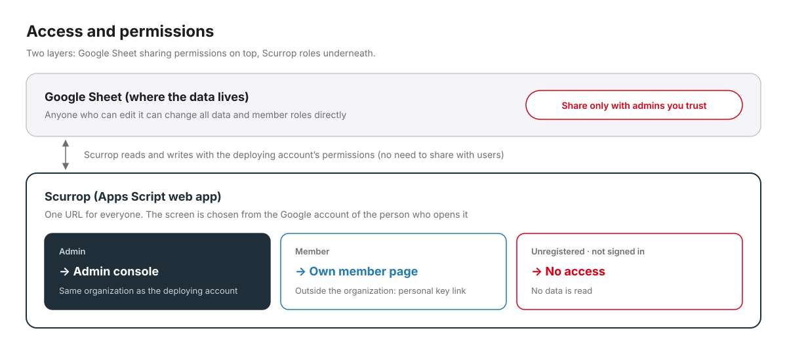

Anyone who can edit the spreadsheet can change all data and member roles directly. Share it only with admins you trust. See [Install and operate](docs/install.md#access-and-permissions) for details.

## Support and contributing

Scurrop is free to use. If you get stuck during setup, you can ask for help.

- Help with setup or customization: [info@hamnism.com](mailto:info@hamnism.com)
- Bugs and requests: [Issues](../../issues)
- Security: [SECURITY.md](SECURITY.md) (please do not post in Issues)
- Pull requests: for larger changes, please open an issue first. Improvements to the English UI text are welcome ([CONTRIBUTING.md](CONTRIBUTING.md))

If Scurrop is useful to you, a ⭐ is appreciated.

Scurrop is an independent project. It is not affiliated with or endorsed by Google. Google Sheets, Apps Script, Gmail, Google Calendar, Google Drive and Google Meet are trademarks of Google LLC.

## License

[MIT](LICENSE)
