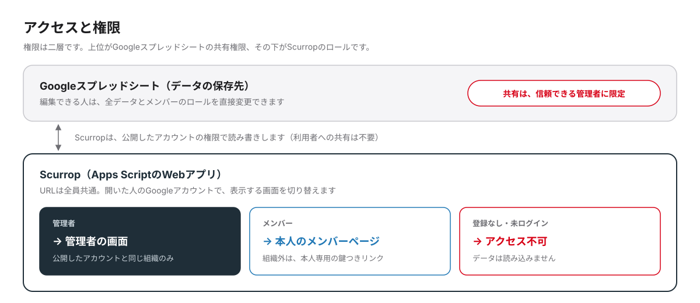

# 導入と運用

[English](install.md) · **日本語**

## 1. コピーして導入（推奨）

1. [雛形のスプレッドシート](https://docs.google.com/spreadsheets/d/1DYKnDnxJ8deLXz4ZKO3neopDikDDZZizAa7m-a_JjVg/copy)を開き、「コピーを作成」をクリックします。スプレッドシートとScurropのコードが、自分のGoogleドライブに複製されます。
2. コピーしたスプレッドシートで「拡張機能」→「Apps Script」を開きます。
3. 日本以外で利用する場合は、「プロジェクトの設定」でタイムゾーンを変更します（[タイムゾーン](#タイムゾーン)）。
4. 「デプロイ」→「新しいデプロイ」を選択し、種類を「ウェブアプリ」、次のユーザーとして実行を「自分」、アクセスできるユーザーを「全員」にしてデプロイします。
5. 表示される画面で権限を承認します（[権限](#権限)）。
6. エディタで関数`authorize`を選択して実行します。すべての権限をまとめて承認し、自分あてに確認メールを1通送信します。
7. ウェブアプリのURLを開き、言語とプロジェクト名を入力して「利用を開始」をクリックします。

ウェブアプリのURLは、スプレッドシートの左端の「URL」シートに記録されます。シートは手順6で作成され、デプロイしたアカウントでウェブアプリを開くと、開いたURLが記録されます。デプロイを追加した場合は、最後に開いたURLが上に表示されます。

### 導入時と利用時に表示される案内

Scurropは、利用者ごとに自分のGoogleアカウントへコードをコピーして動かします。そのため、Googleによる次の案内が表示されます。Scurropの側で非表示にすることはできません。

- **「このアプリはGoogleで確認されていません」**: 個人のGoogleアカウント（gmail.com）では、権限の承認時に表示されます。デプロイ時と`authorize`の実行時の両方で表示される場合があります。コードは自分のアカウントにコピーしたものです。「詳細」から先に進めます。Google Workspaceで、スクリプトの所有者と同じ組織のアカウントで承認する場合は表示されません。
- **「このアプリケーションはGoogle Apps Scriptのユーザーによって作成されたものです」**: デプロイしたアカウントとは別の組織のアカウント（gmail.comなど）でウェブアプリを開くと、画面の上部に表示されます。「×」で閉じられます。デプロイしたアカウントで開いた場合は表示されません。

## 2. 手動で導入

コピー用のリンクを使用できない場合の手順です。

1. 新しいGoogleスプレッドシートを作成し、「拡張機能」→「Apps Script」を開きます。
2. 「プロジェクトの設定」で「「appsscript.json」マニフェスト ファイルをエディタで表示する」をオンにします。
3. 次の4つのファイルに、このリポジトリの`src/`の内容を貼り付けます。

| エディタのファイル | 貼り付ける内容 | 作成方法 |
|---|---|---|
| `コード.gs` | `src/Code.gs` | 最初からあるファイルの内容を置き換え |
| `index.html` | `src/index.html` | ファイル ＋ → HTML。名前は`index` |
| `I18n.gs` | `src/I18n.gs` | ファイル ＋ → スクリプト。名前は`I18n` |
| `appsscript.json` | `src/appsscript.json` | 内容を置き換え |

4. 以降は「1. コピーして導入」の3〜7と同じです。

## 権限

Scurropは、公開したアカウントの権限で動作します。Google以外のサーバーには通信しません。通知メールは、登録したメンバーのアドレスに送信します。ウェブアプリは、URLを知っている人なら誰でも開けます（データを返すのは、登録されたメンバーに対してのみです）。

| 権限 | 用途 |
|---|---|
| スプレッドシート | タスク・メンバー・履歴の保存、稼働リストとレポートの作成 |
| カレンダー | 割り当てたタスクの予定登録、Meetリンクの発行 |
| ドライブ（このアプリが作成したファイルのみ） | 報告の写真、レポート、アーカイブの保存 |
| Gmail（送信のみ） | 招待と通知のメール送信 |
| メール送信（予備） | Gmailで送信できない場合の代替 |
| トリガー | 遅延通知のための定期実行（5分間隔） |
| メールアドレスの確認 | 開いた人のGoogleアカウントの確認 |

## タイムゾーン

日付と時刻は、Apps Scriptのプロジェクトのタイムゾーンで計算します。初期値は`Asia/Tokyo`です。日本以外で利用する場合は、Apps Scriptの「プロジェクトの設定」でタイムゾーンを変更してから、プロジェクトを開始してください。画面の日付と時刻は、端末の設定が別のタイムゾーンでも、このタイムゾーンで表示します。

## アクセスと権限

権限は二層です。上位がGoogleスプレッドシートの共有権限、その下がScurropのロール（管理者・メンバー）です。

- **スプレッドシートを編集できる人は、全データとメンバーのロールを直接変更できます。** 共有は、信頼できる管理者に限定してください。利用者に共有する必要はありません。
- **WebアプリのURLは全員共通です。** 開いた人のGoogleアカウントで、表示する画面を切り替えます。URLを知っているだけでは、管理者の画面は開けません。
- 管理者に設定できるのは、公開したアカウントと同じ組織（Google Workspaceの同一ドメイン）のアカウントのみです。個人のgmail.comで公開した場合、管理者は公開した本人のみです。
- 組織外のメンバーには、本人専用の鍵つきリンクを発行します。このリンクでは、管理者の操作はできません。リンクを知っている人は、そのメンバーとして開けます。リンクは通知メールとカレンダーの予定にも入るため、転送しないようメンバーに伝えてください。漏れた場合は、「メンバー」→「変更」→「再発行」で無効にできます。
- 端末を共用しているメンバーは、自分のページの最下部の「この端末からサインアウト」で、保存されたリンクを削除できます。
- Scurropがドライブに作成するファイル（レポート、稼働リスト、アーカイブ、写真）は、公開したアカウントのものです。ほかの管理者が開くには、「Scurrop - プロジェクト名」フォルダの共有が必要です。
- タスクの「位置情報を記録」をオンにすると、開始・完了時のメンバーの端末の位置がスプレッドシートに保存され、管理者に表示されます。位置は端末からの申告で、検証はしていません。オンにする前に、メンバーに伝えてください。

## 更新

1. Apps Scriptのエディタで、各ファイルの内容を新しい版に置き換えて保存します。
2. 「デプロイ」→「デプロイを管理」→ 編集 → バージョンを「新バージョン」にしてデプロイします。ウェブアプリのURLは変わりません。
3. 権限が追加された版では、関数`authorize`をもう一度実行します。

## 上限

Googleのサービスの上限が適用されます（[Apps Scriptの割り当て](https://developers.google.com/apps-script/guides/services/quotas)）。

| 項目 | 内容 |
|---|---|
| メール | 公開したアカウントの1日の送信上限まで。上限に達した分は送信されず、履歴に記録されます |
| 同時に開く画面 | 目安15画面。超えた場合は読み込みが遅くなります |
| 遅延通知 | 5分間隔で確認します |
| 繰り返しタスク | 1回の登録で最大60件、3か月以内 |
| データ量 | Googleスプレッドシートの上限まで。過去データは、レポートのタブから月単位でアーカイブできます |

## バックアップと削除

- データは、自分のGoogleスプレッドシートとドライブにあります。バックアップは、スプレッドシートのコピーで作成できます。
- リセットとアーカイブは、元に戻せません。実行前にスプレッドシートをコピーしてください。
- 利用を終了する場合は、デプロイを削除（アーカイブ）し、不要であればスプレッドシートとドライブの「Scurrop - プロジェクト名」フォルダを削除します。
