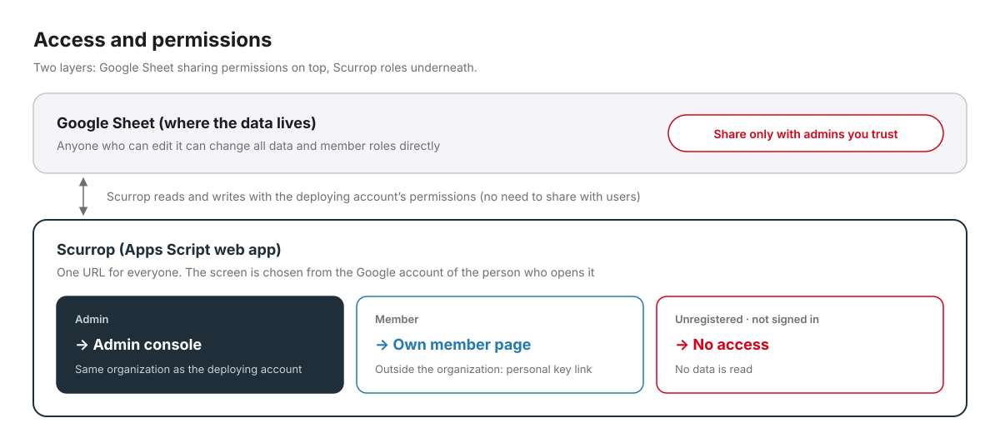

# Install and operate

**English** · [日本語](install.ja.md)

## 1. Install by copying (recommended)

1. Open [the template spreadsheet](https://docs.google.com/spreadsheets/d/1DYKnDnxJ8deLXz4ZKO3neopDikDDZZizAa7m-a_JjVg/copy) and click "Make a copy". The spreadsheet and the Scurrop code are copied to your own Google Drive.
2. In the copied spreadsheet, open Extensions → Apps Script.
3. Outside Japan, change the time zone in Project Settings ([Time zone](#time-zone)).
4. Choose Deploy → New deployment. Set the type to "Web app", Execute as to "Me", and Who has access to "Anyone", then deploy.
5. Authorize the permissions on the screen that appears ([Permissions](#permissions)).
6. In the editor, select the function `authorize` and run it. It grants all permissions at once and sends one confirmation email to yourself.
7. Open the web app URL, choose a language, enter a project name, and click "Get started".

The web app URL is recorded on the "URL" sheet at the left end of the spreadsheet. The sheet is created in step 6, and the URL is recorded when the account that deployed the web app opens it. If you add deployments, the URL opened last is shown at the top.

### Notices shown during install and use

With Scurrop, each user copies the code into their own Google account and runs it there. Because of this, Google shows the notices below. Scurrop cannot hide them.

- **"Google hasn't verified this app"**: With a personal Google account (gmail.com), this appears when you authorize the permissions. It may appear both when you deploy and when you run `authorize`. The code is the copy in your own account. Continue from "Advanced". In Google Workspace, it does not appear when you authorize with an account in the same organization as the script owner.
- **"This application was created by a Google Apps Script user"**: This appears at the top of the screen when the web app is opened with an account outside the deployer's organization (for example, gmail.com). You can close it with "×". It does not appear for the account that deployed the web app.

## 2. Install manually

Use these steps if you cannot use the copy link.

1. Create a new Google Sheet and open Extensions → Apps Script.
2. In Project Settings, turn on "Show "appsscript.json" manifest file in editor".
3. Paste the contents of `src/` in this repository into these four files.

| File in the editor | Paste from | How to create |
|---|---|---|
| `Code.gs` | `src/Code.gs` | Replace the contents of the existing file |
| `index.html` | `src/index.html` | File + → HTML, named `index` |
| `I18n.gs` | `src/I18n.gs` | File + → Script, named `I18n` |
| `appsscript.json` | `src/appsscript.json` | Replace the contents |

4. Then follow steps 3–7 of "Install by copying".

## Permissions

Scurrop runs with the permissions of the deploying account. It does not send data to servers other than Google's. Notification emails go to the member addresses you register, and the web app is reachable by anyone who knows its URL (data is returned only to registered members).

| Permission | Used for |
|---|---|
| Spreadsheets | Storing tasks, members and history; creating the work log and reports |
| Calendar | Adding assigned tasks as events; issuing Meet links |
| Drive (only files created by this app) | Storing report photos, reports and archives |
| Gmail (send only) | Sending invitations and notifications |
| Send mail (fallback) | Used when Gmail sending is unavailable |
| Triggers | Running the late-start check every 5 minutes |
| Email address | Identifying the Google account of the person who opens the app |

## Time zone

Dates and times are calculated in the time zone of the Apps Script project. The default is `Asia/Tokyo`. Outside Japan, change the time zone in Apps Script Project Settings before you start the project. Every screen shows dates and times in this time zone, even on a device set to another one.

## Access and permissions

Permissions have two layers: Google Sheet sharing permissions on top, and Scurrop roles (admin and member) underneath.

- **Anyone who can edit the spreadsheet can change all data and member roles directly.** Share it only with admins you trust. You do not need to share it with users.
- **Everyone uses the same web app URL.** The screen is chosen from the Google account of the person who opens it. Knowing the URL alone does not open the admin console.
- Only accounts in the same organization as the deploying account (the same Google Workspace domain) can be admins. If you deploy from a personal gmail.com account, only that account can be an admin.
- Members outside the organization get a personal link with a key. That link cannot perform admin actions. Anyone who has the link can open Scurrop as that member, and the link is included in notification emails and calendar events, so tell members not to forward them. If a link leaks, reissue it from Members → Edit → Reissue.
- Members who share a device can press "Sign out of this device" at the bottom of their page to remove the saved link.
- Files that Scurrop creates in Drive (reports, the task list, archives, photos) belong to the deploying account. Other admins can open them only after you share the "Scurrop - project name" folder with them.
- When "Record location" is on for a task, the member's device location at start and completion is saved in the spreadsheet and shown to admins. The location is reported by the member's device and is not verified. Tell members before you turn it on.

## Update

1. In the Apps Script editor, replace the contents of each file with the new version and save.
2. Choose Deploy → Manage deployments → Edit, set the version to "New version", and deploy. The web app URL does not change.
3. If the new version adds permissions, run the function `authorize` again.

## Limits

Google service limits apply ([Apps Script quotas](https://developers.google.com/apps-script/guides/services/quotas)).

| Item | Detail |
|---|---|
| Email | Up to the daily sending limit of the deploying account. Messages over the limit are not sent and are recorded in the history |
| Screens open at once | About 15. Beyond that, loading slows down |
| Late-start notifications | Checked every 5 minutes |
| Repeating tasks | Up to 60 tasks per entry, within 3 months |
| Data size | Up to the Google Sheets limit. Past data can be archived by month from the Reports tab |

## Backup and removal

- Your data lives in your own Google Sheet and Drive. To back up, make a copy of the spreadsheet.
- Reset and archive cannot be undone. Copy the spreadsheet first.
- To stop using Scurrop, delete (archive) the deployment and, if no longer needed, delete the spreadsheet and the "Scurrop - project name" folder in Drive.
